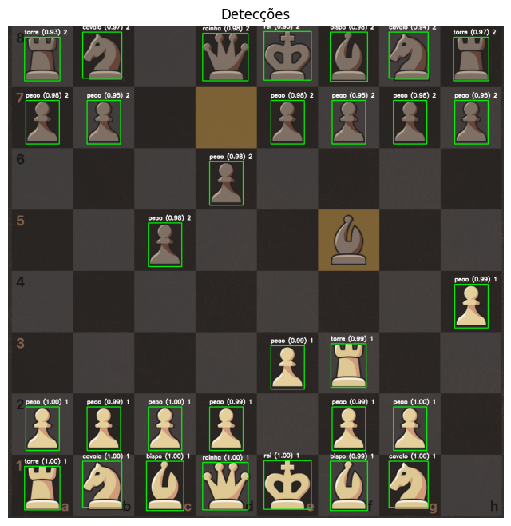
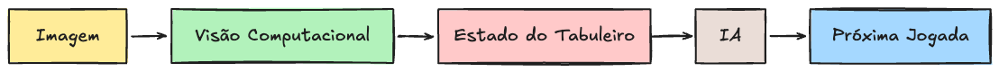

# CP - XADREZ

TURMA:
NOME(S):

## Instruções iniciais

- Clone o repositório
- Preencha o(s) nome(s) dos estudantes
- Faça commits regularmente ao longo do desenvolvimento do CP

## Objetivo

Desenvolver um **sistema de visão computacional para análise de uma partida de xadrez**.

O sistema deverá ser capaz de **localizar as peças, identificar seu tipo, diferenciar a qual jogador cada peça pertence e determinar sua posição no tabuleiro**.

## Referência de jogo

- https://www.chess.com/

## Regras

- Devem ser utilizadas as técnicas vistas em aula até o momento.
- Não podem ser utilizadas técnicas diferentes das estudadas na disciplina.
- Pode utilizar IA como apoio ao aprendizado e ao desenvolvimento.


## Dicas para o resultado parcial

- Comece implementando a detecção de **um único tipo de peça**.
- Depois, generalize sua solução para trabalhar com **mais de um tipo de peça simultaneamente**, até conseguir identificar todas as peças.
- Durante o desenvolvimento, apresente as peças detectadas sobre a imagem do tabuleiro, indicando seu **nome e confiança**.
- Cada peça deve ser detectada **uma única vez**. Caso existam detecções sobrepostas, implemente uma solução de **Non-Maximum Suppression (NMS)** para eliminar as detecções redundantes.
- Implemente uma estratégia capaz de separar as peças em **dois grupos**, representando os dois jogadores.

### Resultado parcial esperado

Nesta etapa, o programa deverá receber uma imagem de um tabuleiro e produzir uma visualização semelhante a um sistema de detecção de objetos, contendo **uma caixa delimitadora para cada peça encontrada**.



Cada detecção deverá possuir informações equivalentes a:

`posição + dimensões + tipo da peça + confiança + cor`

nota max: **5 pontos** 

## Dicas para o resultado final

- Identifique as posições do tabuleiro e faça o **mapeamento de cada peça para sua respectiva casa**.
- Converta o resultado da visão computacional para uma **estrutura de dados padronizada**, que possa ser utilizada posteriormente por uma IA de xadrez.
- Cada peça identificada deverá possuir, no mínimo:
  - tipo da peça;
  - jogador/cor;
  - posição no tabuleiro.

### Resultado final esperado

Ao final, o sistema deverá receber uma imagem do tabuleiro, identificar as peças e gerar uma saída estruturada representando o estado atual da partida.

A saída deverá seguir o seguinte formato:

```python
pecas = [
    {"tipo": "rei", "cor": "branco", "casa": "f6"},
    {"tipo": "rainha", "cor": "branco", "casa": "g6"},
    {"tipo": "rei", "cor": "preto", "casa": "h8"},
    ...
]
```

A estrutura gerada deverá representar corretamente o estado atual do tabuleiro e estar pronta para ser utilizada como entrada por um módulo externo de inteligência artificial para análise da partida.


nota max: **5 pontos** 


---

## BONUS: Integração com a IA de xadrez

Já temos todos os elementos necessários para desenvolver uma solução completa. O desafio bônus é conectar o que foi desenvolvido ao sistema de IA apresentado a seguir. 

O arquivo `ia_xadrez.py` disponibiliza uma IA pronta baseada no algoritmo Minimax com poda alpha-beta.

Exemplo de uso:

```python

from ia_xadrez import melhor_jogada

pecas = [
	{"tipo": "rei", "cor": "branco", "casa": "f6"},
	{"tipo": "rainha", "cor": "branco", "casa": "g6"},
	{"tipo": "rei", "cor": "preto", "casa": "h8"},
]

jogada = melhor_jogada(pecas, turno="branco")
print(jogada) 
```

Cada item de `pecas` deve conter:

- `tipo`: `peao`, `torre`, `cavalo`, `bispo`, `rainha` ou `rei`;
- `cor`: `branco` ou `preto`;
- `casa`: uma casa entre `a1` e `h8`.

A função retorna a melhor jogada em notação UCI, como `g1f3`. 

### Resultado da integração com a IA esperado

Utilize as imagens de tabuleiro fornecidas ou tire um print de uma posição no Chess.com e use esse print como entrada do sistema para:

1. identificar as peças presentes;
2. determinar o tipo e a cor de cada peça;
3. mapear cada peça para sua respectiva casa no tabuleiro;
4. gerar uma estrutura representando o estado atual da partida;
5. utilizar essa estrutura como entrada para o módulo de IA fornecido;
6. apresentar a jogada sugerida pela IA.

O fluxo esperado é:



Demonstre o funcionamento completo desse fluxo de forma integrada.

